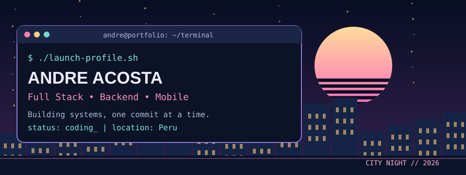
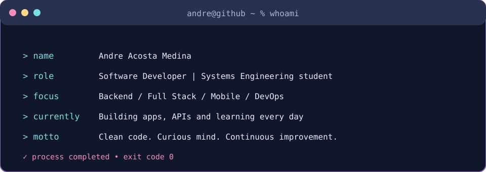
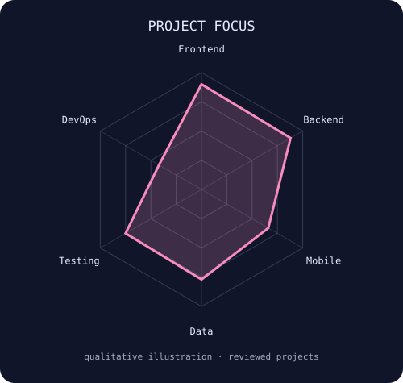
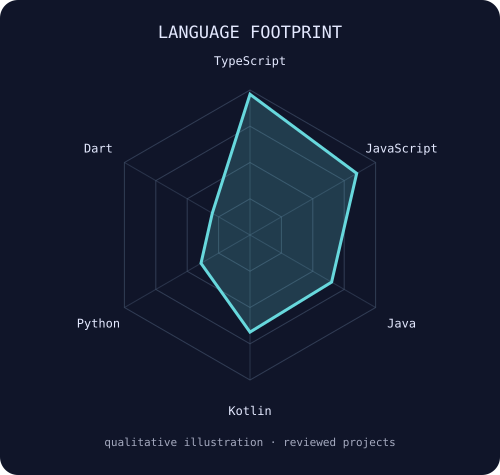

<a href="https://github.com/LouguiAcostaMedina"><picture><source media="(prefers-color-scheme: dark)" srcset="assets/banner-dark.svg"><source media="(prefers-color-scheme: light)" srcset="assets/banner-light.svg"></picture></a>

---
`$ whoami`

<picture><source media="(prefers-color-scheme: dark)" srcset="assets/whoami-dark.svg"><source media="(prefers-color-scheme: light)" srcset="assets/whoami-light.svg"></picture>

I'm a Systems Engineering student at Universidad Peruana Unión (UPeU) and a software developer building web platforms, REST APIs, interactive educational tools and cross-platform mobile applications. My public work currently centers on TypeScript/React, Node.js/Express, Java/Spring Boot and Kotlin Multiplatform.
🧩 Projects: scientific simulations, numerical methods, mission-management systems and mobile applications.
🔬 Working with: testing, software architecture, CI/CD and maintainable deployments.
🌱 Exploring further: DevOps automation, observability, infrastructure and AI.
📬 Contact: lougui.acosta@upeu.edu.pe
---
`$ cat tech-stack.yaml`

<table>
<tr><th colspan="2" align="left"><code>andre@dev:~$ cat tech-stack.yaml</code></th></tr>
<tr>
<td width="50%" valign="top"><code>├─ web_and_languages:</code>   TypeScript · JavaScript · Java · Python · HTML · CSS</td>
<td width="50%" valign="top"><code>├─ frontend:</code>   React · Next.js · Vite · Tailwind CSS · Angular</td>
</tr>
<tr>
<td valign="top"><code>├─ backend_and_apis:</code>   Node.js · Express · Spring Boot · REST APIs</td>
<td valign="top"><code>├─ mobile:</code>   Kotlin · Kotlin Multiplatform · Compose · Flutter / Dart</td>
</tr>
<tr>
<td valign="top"><code>├─ databases_testing:</code>   PostgreSQL · Sequelize · H2 · SQL · Vitest</td>
<td valign="top"><code>╰─ workflow_deployment:</code>   Git · GitHub · Vercel · Linux · CI/CD (learning)</td>
</tr>
<tr><td colspan="2"><code>focus: full_stack | next: automate_test_deploy_observe</code></td></tr>
</table>

---
`$ ./scan-skills.sh`

<picture><source media="(prefers-color-scheme: dark)" srcset="assets/radar-dark.svg"><source media="(prefers-color-scheme: light)" srcset="assets/radar-light.svg"></picture>
<picture><source media="(prefers-color-scheme: dark)" srcset="assets/radar-langs-dark.svg"><source media="(prefers-color-scheme: light)" srcset="assets/radar-langs-light.svg"></picture>

<code>These radars are editorial summaries of public project evidence — not skill proficiency scores or automatic GitHub analytics.</code>

---
`$ ls -la ./featured-projects`
Project	What it demonstrates	Stack	Live / Source
Laboratorio Vectorial	Interactive Physics II simulator covering electrical fields, capacitors, current and magnetism	TypeScript · Vite	Live · Code
NumericaLab	Nonlinear solvers, iterative linear systems, convergence charts and report export	Next.js · React · TypeScript	Live · Code
Kerigma / SGM	Role-based mission management, dashboards, reporting and REST API	React · Node.js · Express · PostgreSQL	Frontend · Backend
PharmaMobile	Kotlin Multiplatform application with Java backend	Kotlin · KMP · Spring Boot	App · API
Live URLs are declared by the repositories and should be rechecked before using them in a professional showcase. Kerigma and PharmaMobile are featured as code projects, without a claim of production deployment.
---
`$ git log --stats`

 

Statistics are provided by third-party services. Language percentages measure repository code, not individual proficiency.
---
`$ connect --socials`

 

Built with care, coffee & curiosity · Andre Acosta Medina · Peru 🇵🇪

